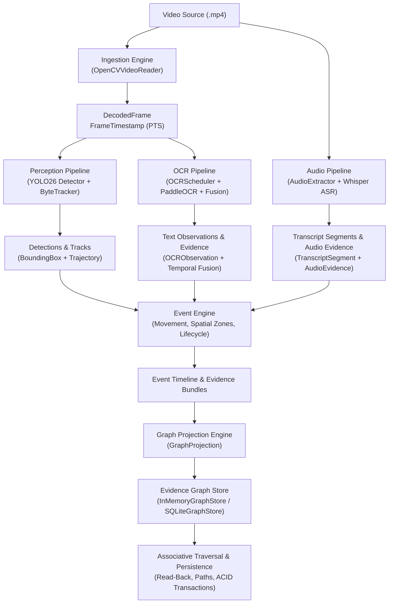

# VIDEX Evidence Pipeline — Provenance, Data Flow & Failure Propagation

## 1. Overview & Architecture

The VIDEX Evidence Pipeline orchestrates multimodal video perception, temporal fusion, associative memory projection, and persistent graph storage. Every analytical output is strictly grounded in immutable source video provenance with presentation timestamp (PTS) traceability.

---

## 2. Provenance Guarantees & Tracing

1. **Source Traceability:**
   - Every `DecodedFrame`, `Detection`, `Track`, `OCRObservation`, and `Evidence` record carries `video_id`, `frame_index`, and `timestamp_seconds` (authoritative container PTS).
   - Timestamp repair mechanisms preserve `original_pts_seconds`, `is_repaired`, and `repair_reason` without corrupting temporal monotonicity.

2. **Perception Grounding:**
   - Bounding boxes conform to Policy A (pixel extents clamped to frame dimensions $[0, W] \times [0, H]$).
   - Track trajectories record historical centroid positions and frame associations.

3. **Multimodal Evidence Grounding:**
   - Temporal OCR fusion clusters text observations across consecutive frames, recording `first_seen_frame`, `last_seen_frame`, `supporting_frames`, and `supporting_observation_ids`.
   - Audio segments preserve start and end PTS timestamps, confidence metrics, and language detection metadata.
   - High-level `Event` records link directly to supporting evidence IDs via `event.evidence_ids`.

4. **Referential Graph Consistency:**
   - `GraphNode` records represent domain entities (`video`, `scene`, `frame`, `detection`, `track`, `ocr`, `transcript`, `event`, `evidence`).
   - `GraphEdge` records establish typed, directed spatiotemporal relationships (`CONTAINS`, `CO_OCCURS`, `APPEARS_IN`, `TEMPORALLY_PRECEDES`, `SPATIALLY_NEAR`).
   - Referential integrity checks verify that no dangling edge endpoints exist in the store.

---

## 3. Persistence & Transaction Safety

1. **Storage Backends:**
   - `InMemoryGraphStore`: Adjacency-indexed in-memory store for high-throughput pipeline execution, sub-millisecond local queries, and atomic JSON export/import.
   - `SQLiteGraphStore`: ACID-compliant relational store with foreign keys, secondary indices, and transactional guarantees.

2. **Idempotency & Replay:**
   - Node and edge identifiers use deterministic hashing / deterministic string keys (`make_node_id`, `make_edge_id`).
   - Re-running graph projection or retrying failed pipeline batches performs idempotent upserts (`INSERT OR REPLACE` / `ON CONFLICT DO UPDATE`), preventing duplicate records.

3. **Failure Propagation & Rollbacks:**
   - Unhandled exceptions during batch persistence trigger explicit `ROLLBACK` via `SQLiteGraphStore.transaction()`, preventing partial or corrupted graph states.
   - Invalid media paths or missing model files raise actionable exceptions (`FileNotFoundError`, `RuntimeError`) rather than returning misleading empty successes.
