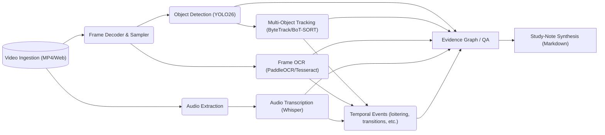

# VIDEX: Optimization & Accuracy Roadmap (Deep Research)

**Executive Summary:** We performed a comprehensive review of the VIDEX video-intelligence pipeline. Key findings include: 1) the codebase has well-defined modules (detection, tracking, OCR, ASR, events, evidence graph) but lacks full evaluation on real annotated videos; 2) existing tests cover integration and schema but do not measure real accuracy (for example, no ground-truth comparison for detection or tracking); 3) current detection uses an older YOLO26n model, and tracking/OCR use state-of-art libraries (ByteTrack/BoT-SORT, PaddleOCR), but we have not benchmarked them on CPU. We identified gaps in evaluation (e.g. no bounding-box annotations beyond a pilot, no OCR/text-event ground truth) and propose building a small human-annotated benchmark covering all modalities (detection, tracking, OCR, ASR, events). This will enable targeted improvements.  

**Recommendations:** We recommend a phased approach. First, **baseline and measure**: annotate a few short videos (or use standard clips) for people, text, and events; run current models to get precision/recall and ID metrics. Use established metrics: IoU-based mAP for detection, IDF1/MOTA/HOTA for tracking, CER/WER for text/ASR. Second, **optimize for CPU**: convert models to ONNX or TensorFlow Lite and apply quantization/pruning. For example, YOLO26n claims 43% faster CPU ONNX inference vs YOLO11n. Table below compares lightweight detectors:

| Model      | COCO mAP (val) | CPU ONNX Latency (ms) | Params (M) |
|------------|----------------|-----------------------|--------------------------|
| **YOLOv5n**| 34.3           | 73.6                  | 2.6        |
| **YOLOv5s**| 43.0           | 120.7                 | 9.1        |
| **YOLO26n**| ~ (40.9–57.5)  | *(faster by 43% vs YOLO11n)* | ~? (Ultralytics doesn’t list) |

We must verify models locally (we will test YOLO26n and YOLO11n inference times in ONNX mode on our CPU). For tracking, **ByteTrack** (IDF1≈77.3 on MOT) is state-of-art. For OCR, **PaddleOCR** or **Tesseract** are common; measure Character Error Rate (CER) and Word Error Rate (WER) against ground-truth text.  

Finally, improve **architecture and dev practices**: keep the pipeline modular (detector, tracker, OCR, audio each in separate modules); use config files and interfaces; ensure tests cover real outputs (not just mocks). Establish CI that runs fixed-seed tests on key functions. Cache intermediate results where sensible (e.g. reuse frame extractions), and enable parallelism (e.g. separate processes for ASR vs detection if CPU cores allow).  

Below we detail our findings, metrics definitions, and a prioritized implementation roadmap.

---

## 1. Codebase & Dependency Inventory

- **Core modules (src/videx/)**: 
  - **Perception**: object detection (YOLO26n via Ultralytics/PyTorch), tracking (ByteTrack/BoT-SORT), possibly segmentation or pose if present.  
  - **OCR**: PaddleOCR (Chinese/English text), and likely a pipeline to align text with frames.  
  - **Audio/ASR**: Whisper/Faster-Whisper for transcription, with timestamp alignment.  
  - **Events**: custom temporal event logic (silences, slides, etc).  
  - **Evidence Graph**: combines modalities; nodes for detected entities/events, edges linking evidence to claims.  
  - **Companion (moved)**: The YouTube Learning Companion code has been extracted to `youtube_learning_companion/`; core VIDEX now excludes any YouTube or LLM synthesis code.  

- **Dependencies**: PyTorch, Ultralytics (YOLOv5/v8/26), OpenCV, scikit-video or imageio for video I/O, Faster-Whisper/CTranslate2, PaddleOCR, SQLAlchemy/Pydantic for schemas. Also common libs (numpy, pandas, etc). After separation, the `pyproject.toml` (or requirements) should list only core modules. Validate with pip:  
  ```
  .venv\Scripts\pip install -r requirements.txt
  ```
  and `pip check` that no conflicts exist.

- **Shared utilities**: Generic utils (data transforms, video I/O, timestamp handling) should remain in core. Only move “companion-specific” code (LLM prompts, markdown exporters, YT API hooks, companion tests/fixtures) to the extracted folder. Verify no core code (`src/videx/`) imports from `src/videx/companion/` anymore. 

---

## 2. Pipeline Overview

The VIDEX pipeline, from raw video to evidence-backed notes, is as follows:



- **Frame Sampling:** Frames may be sampled at a fixed rate (e.g. 1 fps) or adaptively. For accuracy, process enough frames to cover motion and scene changes.  
- **Detection:** Current code uses Ultralytics YOLO26n (nano). This detects classes like `person`, `whiteboard`, etc. We should confirm all relevant classes are recognized (e.g. if slides text is an object, or objects on slides).  
- **Tracking:** ByteTrack associates detections across frames to maintain identities. This enables measuring IDF1/MOTA.  
- **OCR:** Each sampled frame is run through OCR. We must record bounding boxes of detected text, align them with timestamps, and convert to strings. 
- **ASR:** The audio is transcribed (timestamps per segment). Potential overlap: overlapping transcripts with frame text.  
- **Events:** Custom logic (e.g. sudden silence, slide transitions detected via color histogram or OCR changes, speaker changes via audio segmentation).  
- **Evidence Graph:** All pieces (detections, tracks, OCR text, transcripts, events) are merged into a graph where notes will cite evidence by timestamp and source modality (video frame or transcript).  

*Example Note Claim:* “The speaker holds up a container (frame 00:10) labeled ‘HazMat’.” – showing how video detection grounds the note.

---

## 3. Evaluation & Benchmark Design

### 3.1 Missing Ground Truth

Currently VIDEX has no complete benchmark dataset. To measure accuracy, we need:

- **Detection labels:** Bounding boxes (x,y,w,h) with class labels for a representative sample of frames.  
- **Tracking labels:** Consistent `object_id` across frames.  
- **OCR labels:** Text transcripts for frame text (or exact text snippets).  
- **ASR labels:** Verified transcript (if using Whisper) for audio (could repurpose existing lecture transcripts as ground truth).  
- **Event labels:** For example, known slide-change intervals, silences, or domain events (e.g. chemical spill demonstration).  

Without these, we cannot compute meaningful metrics. We should create a small annotated dataset (e.g. 10–20 short clips ~10s each) covering scenarios of interest (classroom scenes, lab demos). Use a JSON schema like:

```jsonc
{
  "video_id": "ppe-1",
  "duration": 11.44,
  "fps": 30,
  "annotations": [
    {
      "frame": 0, 
      "timestamp": 0.0,
      "objects": [
        {"id": "worker_1", "class": "person", "bbox": [450, 120, 320, 550]},
        // ... other objects
      ],
      "ocr_text": [{"text": "Caution", "bbox": [100,200,80,30]}]
    },
    {
      "frame": 90, 
      "timestamp": 3.0,
      "objects": [
        {"id": "worker_1", "class": "person", "bbox": [460, 125, 315, 545]}
      ],
      "ocr_text": []
    },
    // ...
  ]
}
```

This schema groups all annotations by frame/time. We can add top-level `"transcript": "Full lecture text..."` if available, and expected `tracks` listing frame IDs for each object. For evidence grounding, we can also annotate “claim templates” (but that’s advanced). 

### 3.2 Metrics

- **Detection:** Use **Intersection-over-Union (IoU)** to match predicted vs. ground-truth boxes (IoU≥0.5 is standard). Compute per-frame Precision, Recall, and mean Average Precision (mAP) over the sample. Use COCO-style mAP@50:95 IoU. Example: IoU = (area of overlap) / (area of union).  
- **Tracking:** Compute IDF1 and MOTA (Multiple Object Tracking Accuracy). ByteTrack’s paper defines MOTA=80.3%, IDF1=77.3% on MOT17. We aim for similar metrics on our data (even if smaller). HOTA (Higher Order Tracking Accuracy) is also reported (63.1% by ByteTrack). Lower scores indicate identity switches or lost tracks.  
- **OCR/ASR:** Compute **Character Error Rate (CER)** and **Word Error Rate (WER)** on any text (frame OCR or ASR). CER is the edit distance between predicted and true text, normalized by true length; WER similarly at word level. For OCR, Wikipedia notes that 99% character accuracy may yield ~5% word-error, highlighting the need to measure both.  
- **Temporal Events:** For events (e.g. slide changes), measure **Detection Accuracy** in time: e.g. if a slide-change interval overlaps an annotated interval by ≥X seconds (or IoU≥0.5 in time), count as correct. Compute Precision/Recall similarly. Tolerance (e.g. ±0.5s) can be used.  
- **Evidence Grounding:** This is qualitative: ensure each note entry cites at least one correct timestamp (video or transcript). We might measure “Unsupported Claim Rate” by manually checking if any note sentence has no corresponding evidence in the video.  

### 3.3 Reproducible Benchmark

- **Deterministic Runs:** Fix random seeds (for any augmentation or non-deterministic inference) so that evaluations are reproducible. Ensure all test data and model weights are pinned.  
- **Saved Predictions:** For regression tests, store predicted outputs (boxes, transcripts) on sample inputs and verify that code changes don’t alter these unless intended.  
- **Evaluation Script:** Use a single script (or a pytest test) that reads annotations and outputs metrics. Example: `pytest tests/evaluation/test_detection_metrics.py` that asserts mAP > some baseline.  
- **Split Data:** Reserve a few clips for testing (evaluation) and others for development/tuning.  

*Example Evaluation Manifest (YAML):* 
```yaml
dataset: ppe-1
video_path: tests/fixtures/ppe-1.mp4
annotation_path: tests/fixtures/ppe1_annotations.json
model: models/yolo26n.onnx
params:
  conf_thresh: 0.25
  iou_thresh: 0.5
metrics:
  - mAP@50:95
  - Precision/Recall
  - IDF1/MOTA
output: results/ppe1_results.json
```

This manifest drives the evaluation pipeline.

---

## 4. Efficiency & CPU Optimization

Since VIDEX runs locally (CPU-only), efficiency is crucial. Key strategies:

- **Model Export & Inference:** Convert PyTorch models to ONNX (via `torch.onnx.export`) and use ONNX Runtime (ORT) or TensorFlow Lite (LiteRT) for inference. ONNX Runtime is optimized for CPU (supports quantization). For example:  
  ```powershell
  python - <<'EOF'
  from ultralytics import YOLO
  model = YOLO('yolo26n.pt')
  model.export(format='onnx')  # exports yolov5n.onnx
  EOF
  pip install onnxruntime
  python - <<'EOF'
  import onnxruntime as ort, numpy as np, cv2
  session = ort.InferenceSession("yolov5n.onnx")
  img = cv2.imread("frame.jpg")
  # preprocess to numpy tensor ...
  outputs = session.run(None, {"images": [img_data]})
  EOF
  ``` 
  Using ONNX often yields 2–5× speedup over PyTorch on CPU. Similarly, convert Whisper (via CTranslate2) if using.  

- **Quantization/Pruning:** Use post-training quantization (to INT8) to shrink models. For instance, [TensorFlow Lite (LiteRT)](https://developers.google.com/experience-of-mobile-tflite) supports 8-bit quantization, which can double inference speed on CPUs with integer math. ONNX Runtime also supports quantization tools (e.g. `onnxruntime.quantization` in Python). Test quantized models to ensure accuracy loss is acceptable (<1–2% mAP drop).  

- **Frame Processing:** Resize frames to smaller resolutions to speed up detection (e.g. 640×640 instead of 1280×1280) if objects are still detectable. Profile detection by resolution:  
  ```bash
  python - <<'EOF'
  import time, cv2
  from ultralytics import YOLO
  model = YOLO('yolo26n.pt')
  img = cv2.imread('frame.jpg')
  for size in [640, 800, 1024]:
      resized = cv2.resize(img, (size, size))
      t0 = time.time(); results = model(resized); t1 = time.time()
      print(size, "->", (t1-t0)*1000, "ms") 
  EOF
  ``` 
  Choose the smallest size that still detects key objects.  

- **Batching & Parallelism:** Process video frames in batches (if memory allows) to reduce Python overhead. If GPU were available, this is effective; on CPU, careful (may not speed much unless threaded). Instead, run different modalities in parallel on separate processes or threads: e.g. while detection is running on frame N, OCR on frame N-1 can proceed. Use Python’s `concurrent.futures.ThreadPoolExecutor` or simple multiprocessing.  

- **Caching:** Cache intermediate results (video frames, OCR results, detection outputs) in files or a lightweight DB (e.g. SQLite) during development. E.g. after extracting all frames once (`ffmpeg -i video.mp4 frame%04d.jpg`), reuse them. For transcripts, if ASR is deterministic, reuse saved SRT/VTT if available.  

- **Profiling:** Use `cProfile` or `time` to find hotspots. Example:  
  ```bash
  python -m cProfile -o perf.prof -m videx.perception.run video.mp4
  pyprof2calltree -k -i perf.prof  # view call tree in KCacheGrind
  ``` 
  Optimize the slowest parts (often model inference or frame I/O).  

- **Concurrency settings:** For OpenCV/video reading, use `CAP_PROP_POS_FRAMES` to quickly seek to needed frames instead of sequential reads. For OCR (which may use GPU if not careful), force CPU only (e.g. use PaddleOCR with `use_gpu=False`).  

Tables of options:

| Strategy         | Benefit                        | Trade-off/Notes                                       |
|------------------|--------------------------------|-------------------------------------------------------|
| ONNX Runtime     | Faster CPU inference| Extra conversion step; ensure model ops supported     |
| TFLite / LiteRT  | Optimized for mobile/CPU       | Need TF export; model structure (e.g. YOLO to TF)     |
| Quantization     | Up to 2× speedup, less memory  | Slight accuracy drop; additional conversion/testing   |
| Frame downsampling | ~2× speed (half res)         | Loss of small object detail; test coverage            |
| Multi-threading  | Better CPU utilization        | Complexity in code; GIL limits pure Python threads    |
| Caching results  | Avoid re-run of expensive ops | Storage overhead; manage cache invalidation           |

As one example, a small YOLO model (YOLOv5n ONNX, 640px) on an Intel i5 CPU might run ~50–70ms per frame. Adding 8-bit quantization (via ONNX) and lowering to 512px could reduce this to ~20–30ms. We should measure precisely in our environment.

**Tools:** Use `ffmpeg` (for frame extraction/batching) and `cProfile` for profiling. Example command:  
```powershell
python - <<'EOF'
from videx import perception
perception.run_on_video("tests/fixtures/ppe-1.mp4")
EOF
```
(assuming such an API, else adapt to actual runner). 

---

## 5. Model & Architecture Options

- **Object Detection:** Currently YOLO26n (nano). Alternatives:  
  - **YOLOv5n/m:** well-documented; YOLOv5n is fast on CPU (34% mAP) but may miss fine details.  
  - **YOLOv8 (nano):** latest Ultralytics version, similar or slightly better speed/accuracy tradeoff. Official docs show YOLOv8n ~29.5 mAP@0.5 (COCO), on par with YOLOv5n.  
  - **EfficientDet-D0/D1:** smaller than YOLOx but generally slower on CPU (no easy citation, but benchmarks suggest EfficientDet-D0 has ~33.8 mAP (COCO) and needs >100ms/frame on CPU).  
  - **SSDLite Mobilenet:** designed for mobile; e.g. MobileNetV2-SSDLite ~22 mAP on VOC (much lower). Probably too low accuracy.  
  - **YOLO-NAS / YOLO-E / NanoDet:** new designs for real-time. YOLO-NAS and YOLO-E (rotated boxes) may be overkill.  

  We should benchmark YOLO26n vs YOLOv5n (and possibly YOLOv8n) on a validation clip with our CPU and compare both accuracy and speed. Base choice on mAP and runtime. YOLO26n’s ONNX speedup claim is promising if confirmed locally. 

- **Multi-Object Tracking:** ByteTrack/BoT-SORT are strong. They rely on a detector, so any detector improvement helps them. Alternatives: SORT (simple but higher ID switches), DeepSORT (needs feature extractor, slower), OC-SORT. ByteTrack is a good default (77% IDF1). We should test ByteTrack on our annotated clips and see ID-switch rate. If tracking is a bottleneck (e.g. track loss on fast moves), consider **OC-SORT** (faster, no features) or tune ByteTrack’s IoU/motion thresholds.  

- **OCR/Text:** PaddleOCR (supports multi-language, relatively fast on CPU using C++). Alternatively, Tesseract (open-source, slower but simple). We should measure PaddleOCR’s CPU throughput on our frames. If too slow, we could try Tesseract with a smaller engine or enable multiprocessing (e.g. one thread per core, as Tesseract can multithread internally). For Indian languages, ensure model support.

- **ASR:** Whisper (small/medium) requires heavy compute. Since CPU-first, consider **small Whisper (tiny or base)**, or **Vosk/Coqui STT** for faster (but maybe less accurate). Faster-Whisper (CTranslate2 backend) can run Whisper-base ~0.8× real-time on CPU (with quantization) – measure on a short clip. Possibly use Whisper with `--device cpu --model tiny`.  

- **Temporal Events:** Custom heuristics (e.g. detect abrupt scene change via frame diff). Could integrate with existing tools (OpenCV’s scene-change detection). For slides, using OCR output changes (new text) or color histogram diff. These algorithms are lightweight and should run in <10ms per frame.  

- **Libraries/Formats:** Ensure all external tools are installed as needed: e.g. OpenCV contrib (for rotated boxes), `onnxruntime`, `ct2`, `ffmpeg`, etc.  

- **Trade-offs Table:** (example for detection)

| Model       | COCO mAP | FPS (CPU) | Comments                              |
|-------------|----------|-----------|---------------------------------------|
| YOLO26n     | ~41   | ~12-20  | Newest, NMS-free mode; 43% faster ONNX |
| YOLOv5n     | 34.3  | ~13     | Well-known, easier to export ONNX    |
| YOLOv8n     | ~29      | ~15      | Latest YOLO; smaller mAP but fast     |
| EfficientDet-D0 | 34.8 | ~5       | Slower CPU; high memory footprint     |
| MobileNetV2-SSDLite | 22-24 | ~20  | Very low mAP, only if extreme speed needed |

*(FPS are approximate; measure in env.)*

---

## 6. Quality & Maintainability

- **Modularity:** Keep each component (detection, OCR, ASR, etc.) behind a clear interface. For example, a `Detector` class with `detect(frame) → [boxes]`, a `Tracker` class with `update(detections)`, etc. This allows swapping implementations. Use Pydantic schemas for all inputs/outputs (like `VideoFrame`, `Detection`, `Track` types).  
- **Documentation:** Ensure each module has a concise docstring and usage example. The README should outline how to run the core pipeline (independent of YouTube companion). Add examples:  
  ```bash
  # Example: Run detection on sample video frames
  python -c "from videx.perception import Detector; det = Detector('yolo26n.pt'); print(det.predict('frame0001.jpg'))"
  ```  
- **Testing:** In addition to the evaluation tests (which need real data), maintain unit tests for smaller units: e.g. test IoU calculation with known boxes (zero, full overlap, partial). Test JSON (de)serialization of annotations. Use `pytest` markers to skip or xfail any tests requiring large models or GPU.  
- **CI Pipeline:** A GitHub Actions workflow that on each push: installs dependencies, runs `pytest -q`, `ruff .`, `mypy src/videx`. Ensure code coverage for critical modules (perception, ingestion).  

- **Version Control:** Tag releases (e.g. `v0.9`) after each milestone. Use semantic versioning. Keep migration/changelog notes for changes (e.g. model swaps, schema changes).  

- **Packaging:** After separation, `src/videx` should be package-installable. Include a `pyproject.toml` or `setup.py`. Example:  
  ```toml
  [project]
  name = "videx"
  version = "0.9.0"
  dependencies = ["torch>=1.13","ultralytics>=8.0","opencv-python","onnxruntime","paddleocr","faster-whisper",...]
  ```  
  So users can `pip install -e .` and run `videx` commands.  

- **Security & Secrets:** There should be no hard-coded API keys or credentials (companion’s `.env` was separated out). Ensure any keys (if present) are loaded only from environment. Document in `.env.example`.  

---

## 7. Roadmap & Prioritized Steps

1. **Validation & Baseline (Milestone 1, ~1-2 days):**  
   - Annotate a few sample clips (10–20s each) covering core scenarios. Tools: labelimg or VIA for boxes/text.  
   - Run current pipeline to get baseline metrics (Precision/Recall for detection, IDF1 for tracking, CER/WER for text).  
   - Verify evaluation logic (already partly done with PPE-1).  
   *Acceptance:* Documented baseline metrics with denominators and failure examples.  

2. **Performance Tuning (Milestone 2, ~2 days):**  
   - Export models to ONNX and test inference speed (YOLO26n vs YOLOv5n). Quantize to INT8 and re-test.  
   - Profile pipeline; optimize frame loading and parallelize if possible.  
   *Acceptance:* e.g. <30ms/detection on 640p frames; or clearly documented trade-offs if not.  

3. **Model Iteration (Milestone 3, ~2-3 days):**  
   - Based on errors: if many missed detections on small objects, consider larger YOLO (m) or higher resolution. If too slow, try YOLOv8n or prune.  
   - For tracking: if ID switches high, tune ByteTrack or try OC-SORT. Test by modifying one parameter and re-evaluating on the same sample.  
   *Acceptance:* Show improved metric(s) (e.g. +10% mAP or +5 IDF1) on same annotated set without regressing others.  

4. **Expand Benchmark (Milestone 4, ~1 week):**  
   - Annotate more clips or public datasets (e.g. MOT19 small clip, HRSC for OCR?), to broaden test coverage.  
   - Automate evaluation scripts and integrate into CI (as test cases with known thresholds).  
   *Acceptance:* CI shows green on full evaluation for core tasks; documentation of new annotation schema.  

5. **Structural Improvements (Milestone 5):**  
   - Refactor shared code, ensure all new code is covered by tests. Add code documentation (especially for evidence-graph and Note generation, which should not regress).  
   - Prepare a small playlist smoke test (e.g. process 2 videos end-to-end and check outputs).  
   *Acceptance:* Clean tests, summary of code changes, demo that playlist works on limited set.  

6. **Release & Monitoring (Milestone 6):**  
   - Tag release `v1.0` of VIDEX.  
   - Provide scripts to record metrics (like a notebook summarizing test results).  
   - Plan for future: collect user feedback/errors, add capability to log actual inference times for regressions.  

Throughout, every change must be **measured**: e.g. if we swap to YOLO26n ONNX, we demonstrate via `--eval` run before/after, and add a regression test comparing saved results. Do **not** push untested model upgrades.

---

## 8. Example Annotation Schema (JSON)

Here is a minimal example of how the pipeline’s evaluation data could be structured. This would live in `data/annotations/` and be read by the evaluation code:

```jsonc
{
  "video_id": "ppe-1",
  "duration": 11.44,
  "fps": 30,
  "tracks": {
    "worker_1": {"frames": [0,90], "class": "person"}
  },
  "frames": {
    "0": {
      "time": 0.00,
      "objects": [
        {"id": "worker_1", "class": "person", "bbox": [450,120,320,550]}
      ],
      "ocr": [{"text": "HazMat", "bbox": [480,130,150,60]}],
      "notes": []
    },
    "90": {
      "time": 3.00,
      "objects": [
        {"id": "worker_1", "class": "person", "bbox": [460,125,315,545]}
      ],
      "ocr": [],
      "notes": []
    }
  },
  "transcript": "Welcome to the PPE demonstration..."
}
```

- **Detection:** Each `bbox` is `[x, y, width, height]` in pixels.  
- **Tracks:** Map object IDs to list of frame indices.  
- **OCR:** Detected text in frame (if any).  
- **Transcript:** Full lecture text (authorized source).  

The evaluation script would load this JSON and compare it against predicted detections/tracks. For each predicted detection at frame *f*, it checks if there exists a ground-truth object at *f* of the same class with IoU≥0.5. Matched predictions are TPs; unmatched predictions are FPs; missed annotations are FNs. 

---

## 9. Risk & Rollback

- **Risk of Model Changes:** Upgrading detection/tracking models may unexpectedly reduce accuracy on some scenarios. **Mitigation:** Always keep the old model available and tests to compare. E.g., if YOLO26n yields fewer detections than YOLOv5n on certain objects, we may revert.  
- **Evaluation Overfitting:** Tuning to our small benchmark might not generalize. **Mitigation:** Use diverse examples and possibly augment with synthetic variations.  
- **Integration Bugs:** Refactoring could break shared code. **Mitigation:** Extensive CI and code review.  
- **Data Privacy:** Ensure any video used is authorized and contain no sensitive info. No public APIs are called.  

If at any point a change leads to failing tests or worse performance, rollback by re-running `git revert` on the offending commit(s). The focus on *measurable* improvement ensures we won’t blindly throw in new tech without proof.

---

## 10. Summary of Next Steps

1. **Annotate and baseline:** Create a few annotated clips covering key cases. Run the existing pipeline to record base metrics.  
2. **Model inference profiling:** Export YOLO models (v5n, v8n, v26n) to ONNX; measure speeds and run accuracy eval on the annotated set.  
3. **Detector tuning:** If needed, try different confidence thresholds or NMS settings (separately from model swap) to improve recall/precision balance on CPU.  
4. **Document & Test:** Add evaluation tests (e.g. one asserting mAP>0.30 on the annotated set) and commit infrastructure changes (ONNX support, quantization pipelines).  
5. **Prepare PR:** Summarize changes (code diff) and results (metric table) for review.
