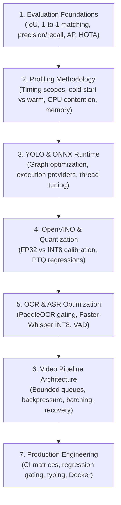

# VIDEX Technical Research Library

Welcome to the internal technical research library for **VIDEX** (Video Intelligence & Directed Evidence Extraction).

This directory maintains version-controlled research notes, foundational papers, benchmark methodologies, and runtime profiling studies that directly inform architectural decisions in VIDEX. Rather than collecting disorganized bookmarks, each note in this library anchors an engineering question to current VIDEX empirical evidence, official documentation, primary scientific literature, candidate approaches, failure modes, and concrete experiments.

---

## 1. Research Note Index

| Document | Primary Domain | Focus Areas | Relevant ADR | Status |
| :--- | :--- | :--- | :--- | :---: |
| [**detection-and-evaluation.md**](file:///c:/Users/Swastik%20Pandey/Downloads/VIDEX/docs/research/detection-and-evaluation.md) | Object Detection & Ground Truth | YOLO26, COCO AP/mAP, IoU assignment, annotation provenance, sampling bias | [ADR-001](file:///c:/Users/Swastik%20Pandey/Downloads/VIDEX/docs/decisions/ADR-001-detector.md) | **Active** |
| [**cpu-inference-optimization.md**](file:///c:/Users/Swastik%20Pandey/Downloads/VIDEX/docs/research/cpu-inference-optimization.md) | Inference Acceleration | ONNX Runtime, OpenVINO, INT8 quantization, thread affinity, PyTorch Profiler | [ADR-001](file:///c:/Users/Swastik%20Pandey/Downloads/VIDEX/docs/decisions/ADR-001-detector.md) | **Active** |
| [**tracking-and-temporal-events.md**](file:///c:/Users/Swastik%20Pandey/Downloads/VIDEX/docs/research/tracking-and-temporal-events.md) | Spatio-Temporal Association | BoT-SORT, ByteTrack, HOTA/IDF1, Kalman filters, temporal reasoning (SlowFast/TSN) | [ADR-002](file:///c:/Users/Swastik%20Pandey/Downloads/VIDEX/docs/decisions/ADR-002-tracker.md) | **Active** |
| [**ocr-and-asr.md**](file:///c:/Users/Swastik%20Pandey/Downloads/VIDEX/docs/research/ocr-and-asr.md) | Multimodal Perception | PaddleOCR (PP-OCRv6), keyframe gating, Faster-Whisper, VAD, timestamp alignment | [ADR-003](file:///c:/Users/Swastik%20Pandey/Downloads/VIDEX/docs/decisions/ADR-003-ocr.md), [ADR-004](file:///c:/Users/Swastik%20Pandey/Downloads/VIDEX/docs/decisions/ADR-004-asr.md) | **Active** |
| [**benchmarking-methodology.md**](file:///c:/Users/Swastik%20Pandey/Downloads/VIDEX/docs/research/benchmarking-methodology.md) | Evaluation & Measurement Science | Timing scope discipline, statistical metrics (p90/p99), memory profiling, regression CI | [Roadmap](file:///c:/Users/Swastik%20Pandey/Downloads/VIDEX/docs/evaluation/VIDEX_Optimization_and_Accuracy_Roadmap.md) | **Active** |

---

## 2. Priority Learning Sequence

To make immediate progress without drowning in literature, follow the prioritized study order:

### Priority Tiers
- **P0 (Immediate Execution):**
  1. **YOLO26 & Ultralytics** — Ingest prediction, export options, confidence thresholds, and output tensor format.
  2. **ONNX Runtime** — Session options, graph optimization levels, thread configuration, CPU execution provider (`CPUExecutionProvider`).
  3. **Object Detection Evaluation** — One-to-one matching algorithms, IoU thresholds, precision-recall curve integration, ground-truth auditability.
  4. **OpenVINO** — Intel CPU acceleration alternative, throughput vs latency modes, model optimizer.
  5. **PaddleOCR** — Decoupled detection vs recognition, keyframe gating to alleviate the measured ~53.6s bottleneck.
  6. **PyTorch Profiler** — Memory allocations, kernel traces, operator-level overhead analysis.
- **P1 (Near-Term Expansion):**
  - Multi-Object Tracking metrics (HOTA, IDF1, MOTA, ID switches via TrackEval).
  - Audio transcription acceleration via Faster-Whisper (CTranslate2 INT8, VAD filtering).
- **P2 (Architecture & Production):**
  - Bounded-queue streaming pipelines, temporal event reasoning, and automated regression testing.

---

## 3. Standard Research Note Structure

Every research note in `docs/research/` follows this mandatory 8-section template:

1. **Problem and Engineering Question:** What exact architectural or performance challenge are we addressing?
2. **Current VIDEX Implementation and Evidence:** Concrete file paths, baseline metrics, and current system behavior.
3. **Official Documentation and Primary Papers:** Curated primary sources and canonical papers with hyperlinks.
4. **Candidate Approaches and Hardware Requirements:** Architectural alternatives and target hardware feasibility (e.g. CPU-only vs GPU).
5. **Expected Trade-offs and Failure Modes:** What could go wrong (e.g. accuracy regression, memory leaks, latency spikes).
6. **Proposed Experiment and Acceptance Criteria:** Hypothesis-driven benchmark protocol with explicit pass/fail gates.
7. **Actual Experiment Results (Kept Separate):** Empirically verified data, kept strictly segregated from theoretical hypotheses.
8. **Decision, Rationale, and Link to Relevant ADR:** Actionable recommendation linked to `docs/decisions/ADR-xxx.md`.

---

## 4. Key Engineering Rule: Parity vs. Accuracy

> [!IMPORTANT]
> **A model producing similar boxes is NOT the same as the model producing equally good detections.**
> - **Runtime Parity Tests** compare two implementations of the same model (e.g., PyTorch CPU vs. ONNX Runtime CPU) on identical frames to verify numerical consistency ($\Delta \text{bbox} < \epsilon$).
> - **Independent Ground-Truth Evaluation** measures real-world accuracy against human-annotated ground-truth labels.
> 
> VIDEX requires **both**: parity tests to validate optimization integrity without regressions, and independent ground-truth evaluation to establish true domain performance.
